# PreConsulta — Cliente Android Nativo (`telemed-preconsult-android`)

Aplicación móvil nativa en **Kotlin y Jetpack Compose (Material 3)** para preparación de teleconsultas médicas: captura síntomas por voz, registra signos vitales domiciliarios en tarjetas táctiles, realiza de **1 a 3 preguntas breves ("Ayúdame con más información")** y entrega tanto el **Pase del Paciente** como la **Ficha Clínica (`SOAP` / `ISBAR`)** mediante navegación inferior nativa.

- **Aplicación Web Compañera (Producción):** [https://telemed-preconsult-ai.vercel.app](https://telemed-preconsult-ai.vercel.app)
- **Repositorio Web Compañero:** [`ykro/telemed-preconsult-ai`](https://github.com/ykro/telemed-preconsult-ai)
- **Especificación Técnica:** [SPEC.md](./SPEC.md)
- **Arquitectura del Cliente Android:** [docs/ARCHITECTURE.md](./docs/ARCHITECTURE.md)
- **Guía de Instalación y Emulador:** [docs/ONBOARDING.md](./docs/ONBOARDING.md)
- **Índice General de Proyectos:** [`ykro/ilab-aibuilders-prototypes`](https://github.com/ykro/ilab-aibuilders-prototypes)

---

## ¿Para qué se usa Gemma 4 E2B en la App Móvil y por qué en Android Nativo sí y en Web no?

### 1. Rol de Gemma 4 E2B en Telemedicina
1. **Privacidad y pre-procesamiento local (*On-Device*):** Permite anonimizar identificadores sensibles (DPI, teléfonos) y estructurar el relato de síntomas directamente en el dispositivo del paciente sin depender de servicios externos.
2. **Interrogatorio OPQRST y triaje offline en zonas sin cobertura:** En brigadas médicas rurales, puestos de salud o comunidades con conectividad móvil inestable, **Gemma 4 E2B** evalúa qué variables semiológicas del protocolo **OPQRST** faltan para formular de **1 a 3 preguntas de seguimiento**, clasifica el nivel de prioridad (`ROJO`, `AMARILLO`, `VERDE`) y construye la nota clínica `SOAP` / `ISBAR` completamente fuera de línea.
3. **Enrutamiento híbrido:** Cuando el teléfono cuenta con conexión estable, sincroniza con el backend en la nube (**Gemini 3.8 Flash**); cuando pierde señal o requiere procesamiento local, **Gemma 4 E2B** garantiza continuidad clínica sin interrupciones.

### 2. ¿Por qué Gemma 4 E2B se integra en la App Móvil Nativa y no en la versión Web?
- **Tamaño del modelo y almacenamiento persistente:** El modelo cuantizado **Gemma 4 E2B** (~1.3 GB – 1.5 GB en formato `.task` de LiteRT/MediaPipe) se descarga una sola vez en el almacenamiento interno de Android y queda disponible permanentemente. En una aplicación web móvil, descargar más de 1.3 GB desde el navegador antes de iniciar una consulta médica sería inviable en redes celulares y superaría los límites de almacenamiento caché de los navegadores móviles.
- **Acceso directo a GPU y NPU del teléfono:** A través del SDK nativo de Android (**MediaPipe Tasks GenAI / LiteRT**), la aplicación utiliza directamente los aceleradores de hardware (GPU/NPU) del dispositivo con gestión nativa de memoria, evitando los cierres por límite de RAM (*Out-Of-Memory*) que ocurren en WebAssembly/WebGPU dentro de navegadores móviles.
- **Complementariedad con la versión Web:** La versión web ([`telemed-preconsult-ai`](https://github.com/ykro/telemed-preconsult-ai)) está pensada para acceso inmediato sin instalación (por enlace o código QR) ejecutando la inferencia en la nube con **Gemini 3.8 Flash**, mientras que esta aplicación nativa Android habilita la experiencia móvil completa y la ejecución local con **Gemma 4 E2B**.

---

## Experiencia Nativa Android (Material 3)

La interfaz fue diseñada específicamente con patrones nativos móviles de **Jetpack Compose y Material 3** (no como una vista web):
- **`Scaffold` con `TopAppBar` nativo e indicador lineal de progreso (`1/3`, `2/3`, `3/3`)** y navegación hacia atrás integrada.
- **Barra de acción inferior fija en zona del pulgar (`NativeBottomActionSheet`):** El botón principal de avance permanece anclado en la parte inferior de la pantalla con contraste clínico activo durante la inferencia local.
- **Tarjetas táctiles 2x2 de altura uniforme para signos vitales** con indicadores clínicos semánticos (`Normal`, `Fiebre`, `Vigilar`, `Elevado`, `Elevada`) y barra de dictado por voz con botón tipo píldora (`RecognizerIntent` + `TextToSpeech` en `es-GT`).
- **Stepper interactivo de 1 pregunta a la vez (`Step 2: Ayúdame con más información`):** Píldoras superiores (`Pregunta 1`, `Pregunta 2`, `Pregunta 3`), tarjeta activa enfocada con opciones de radio y resumen inferior compacto (`P1`, `P2`, `P3`) con botón `Editar` para que toda la vista quepa en pantalla sin desplazamiento vertical.
- **Barra de navegación inferior nativa (`NavigationBar` en `Step 3`)** que divide los resultados en tres vistas móviles limpias que caben íntegramente en pantalla:
  1. **`Mi Pase`**: Banner de prioridad clínica en la parte superior, tira resumen de signos vitales, motivo principal, tabla compacta de respuestas de seguimiento, lectura en voz alta y botón para compartir por WhatsApp/Correo (`Intent.ACTION_SEND`).
  2. **`Preparación`**: Tira compacta de prioridad, lista de verificación interactiva con casillas (`NativeCheckboxSquare`), contador de progreso y preguntas sugeridas para el médico.
  3. **`Ficha Médica`**: Conmutador nativo de tres protocolos (`SOAP` / `ISBAR` / `OPQRST`), alertas clínicas (*Red Flags*) y copia directa al portapapeles (`ClipboardManager`).

---

## Arquitectura del Cliente Android

### 1. Enrutamiento Híbrido Online y Offline (Edge + Cloud)



### 2. Capas de Presentación, Estado y Motor Clínico en Android



---

## Temas para Artículos Técnicos y de Producto

1. **IA en el dispositivo (`Gemma 4 E2B`) frente a inferencia en la nube (`Gemini 3.8 Flash`) en aplicaciones médicas móviles:** Análisis arquitectónico sobre persistencia de modelos cuantizados (~1.3 GB), aceleración por hardware en GPU/NPU móvil mediante LiteRT/MediaPipe y las razones técnicas por las que la inferencia local funciona de forma óptima en una app nativa Android pero resulta inviable dentro de un navegador web móvil.
2. **De formulario web a experiencia móvil nativa en Jetpack Compose (Material 3) para pacientes con síntomas agudos:** Decisiones de diseño e ingeniería de interfaz móvil orientadas a reducir la carga cognitiva del paciente: stepper interactivo de una sola pregunta a la vez sin necesidad de hacer scroll, barra de acción en la zona del pulgar y tarjetas de signos vitales con alertas semánticas en tiempo real.
3. **Arquitectura híbrida offline-first para triaje clínico en brigadas rurales y zonas de baja conectividad:** Cómo estructurar un cliente móvil capaz de ejecutar anonimización de PII, interrogatorio OPQRST, detección de banderas rojas y generación de fichas `SOAP` / `ISBAR` completamente fuera de línea y sincronizar cuando vuelve la cobertura.
4. **Ejecución de inferencia local en Android con Kotlin Coroutines (`Dispatchers.IO`) y gestión de memoria para modelos cuantizados `.task`:** Cómo aislar el motor `GemmaLocalEngine` del hilo principal (`UI Thread`), evitar bloqueos de fotogramas (`jank`) en Compose y mantener tiempos de respuesta sub-segundo en dispositivos móviles.
5. **Sistema de iconografía y controles clínicos vectoriales en Jetpack Compose usando primitivas `Canvas` y `DrawScope`:** Cómo implementar casillas de verificación (`NativeCheckboxSquare`), selectores de radio (`NativeRadioCircle`) e iconos médicos mediante trazos vectoriales directos en código sin depender de paquetes pesados de recursos ni iconos de terceros.
6. **Integración reactiva de `RecognizerIntent` (`ActivityResultContracts`) y ciclo de vida de `TextToSpeech` en Jetpack Compose:** Manejo seguro de contratos de voz del sistema Android y liberación determinista del motor TTS mediante `DisposableEffect` dentro de una arquitectura de navegación por pasos.

---

## Compilación y Ejecución en Emulador

```bash
./gradlew assembleDebug
adb install -r app/build/outputs/apk/debug/app-debug.apk
adb shell am start -n com.example.telemedpreconsultai/.MainActivity
```
