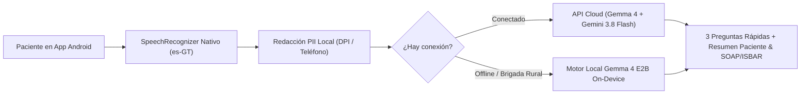
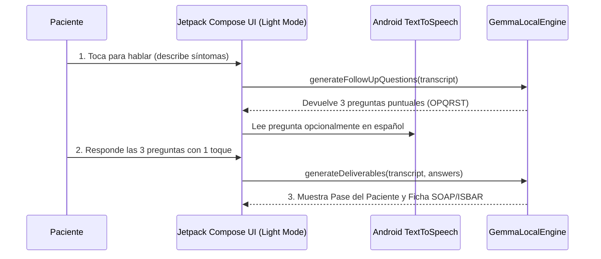
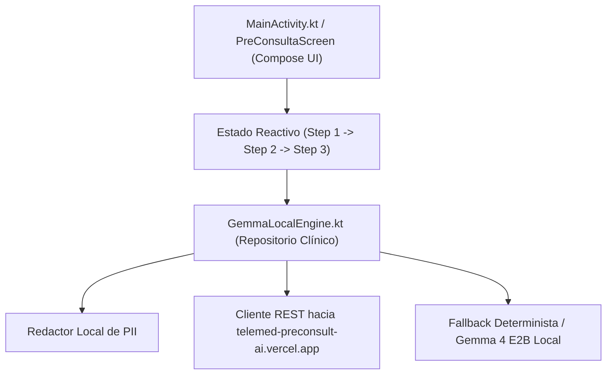

# Telemed Pre-Consult AI — Cliente Android Nativo (`telemed-preconsult-android`)

Cliente móvil nativo en **Kotlin + Jetpack Compose (100% Light Mode)** para captura rápida de síntomas por voz, 3 preguntas dinámicas de seguimiento y generación del **Pase de Pre-Consulta del Paciente** y la **Ficha Clínica (SOAP / ISBAR)**, diseñado para operar tanto conectado como en modo offline con **Gemma 4 E2B**.

- **Aplicación Web Compañera (Deploy en Producción):** [https://telemed-preconsult-ai.vercel.app](https://telemed-preconsult-ai.vercel.app)
- **Repositorio Web Compañero:** [`ykro/telemed-preconsult-ai`](https://github.com/ykro/telemed-preconsult-ai)
- **Especificación Técnica:** [Ver SPEC.md](./SPEC.md)
- **Guía de Onboarding e Instalación Android:** [Ver docs/ONBOARDING.md](./docs/ONBOARDING.md)
- **Índice General de Proyectos:** [`ykro/hackathon-prototipos-index`](https://github.com/ykro/hackathon-prototipos-index)

---

## Arquitectura del Cliente Android (3 Diagramas)

### 1. Arquitectura Híbrida Offline / Cloud (Gemma 4 E2B + Gemini 3.8 Flash)

### 2. Flujo de Interacción en 3 Pasos (Minimalista y sin Fricción)

### 3. Estructura de Capas del Proyecto Android

---

## Estructura de Documentación
- **[SPEC.md](./SPEC.md):** Alcance técnico del cliente Android y esquema de datos.
- **[docs/ONBOARDING.md](./docs/ONBOARDING.md):** Instrucciones para abrir en Android Studio, compilar el APK con `./gradlew assembleDebug` y ejecutar en emulador o dispositivo físico.
